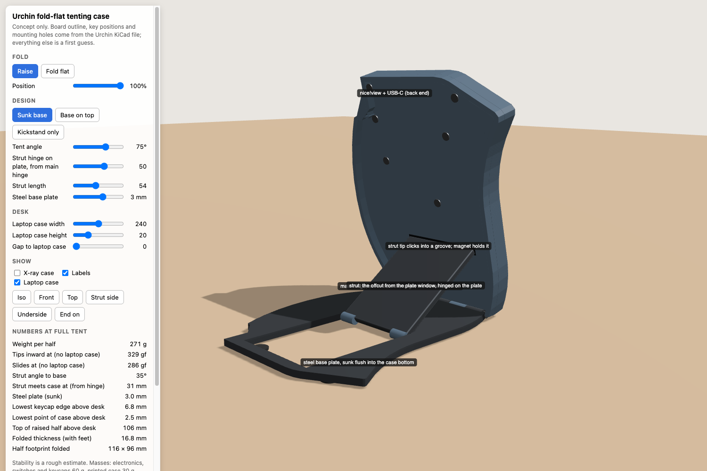

# Urchin fold-flat tenting case

A design for a case for the [Urchin](https://github.com/duckyb/urchin) split keyboard. It encloses the PCB, folds flat for carrying, and stands each half at a fixed tent of about 75° without tools or friction hinges.

Each half's case sits on a steel base plate that is sunk flush into its underside. The case swings up on a free-running hinge along the pinky edge. A strut, cut from a window in the plate, swings up and clicks into a groove under the case. That forms a rigid triangle, so the angle never depends on friction. The steel base keeps each half planted.

Status: concept only, no CAD yet. See [HANDOFF.md](HANDOFF.md) for the requirements, the decisions and the open questions.

## Contents

- `viewer/index.html`: an interactive 3D concept viewer that you open in a browser. It compares three concepts and shows live stability, height and thickness estimates.
- `renders/`: screenshots from the viewer.
- `data/urchin-right-half.json`: the right half's PCB outline, key positions, mounting holes and part positions, taken from the Urchin KiCad file.
- `tools/extract_pcb.py`: regenerates the data file from the Urchin `main.kicad_pcb`.
